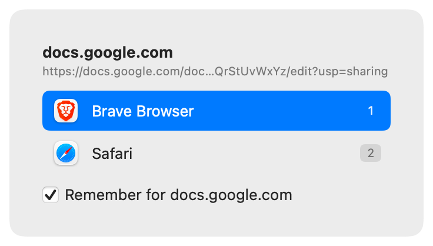
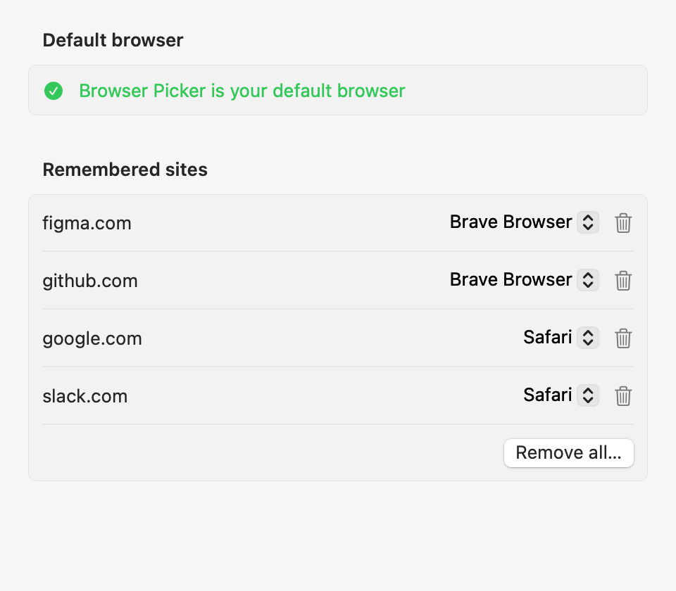

# Browser Picker

A small macOS menu bar app that becomes your default web browser and decides, for every `http`/`https` link, whether to open it straight away in a remembered browser or ask you which browser to use.

## What it does

- Registers as a web browser, so macOS sends it every `http`/`https` link you click in other apps.
- Links whose domain you have remembered open straight in the chosen browser, with no UI.
- Any other link shows a small keyboard-first picker at the cursor listing your installed browsers, with one row per profile for Chromium browsers and Firefox.
- Runs in the menu bar only (no Dock icon). Everything stays on your Mac: no network, no link history.

<p align="center">
  
  
</p>

## Requirements

- macOS 14 or later to run the app
- A Mac with Apple silicon to use the ready-made download. Intel Macs can build it from source.
- To build from source only: a Swift 6 toolchain, either Xcode 16 or later or the Xcode command line tools (`xcode-select --install`). These need macOS 14.5 or later, so the app can't be built on macOS 14.0–14.4.

## Download

No Xcode needed:

1. Download `Browser-Picker-<version>.zip` from the [latest release](https://github.com/zhendawgfr/browser_picker/releases/latest).
2. Open the zip and move `Browser Picker.app` to `/Applications`.
3. Open it. The app is not notarized by Apple, so the first time macOS says it can't verify it and won't open it. Click **Done**, then go to System Settings → Privacy & Security, scroll to Security, click **Open Anyway** next to "Browser Picker was blocked", and confirm. macOS remembers this for that copy of the app.

   If you prefer Terminal, this does the same: `xattr -dr com.apple.quarantine "/Applications/Browser Picker.app"`.

To update, quit Browser Picker, replace the app with the new download, and repeat step 3. Each release is a new ad hoc build, so re-add it under Full Disk Access too (see "Grant access").

## Build from source

```bash
git clone https://github.com/zhendawgfr/browser_picker.git
cd browser_picker
scripts/build-app.sh
```

The script builds a release binary, assembles `Browser Picker.app`, signs it ad hoc, and installs it to `/Applications/Browser Picker.app`, next to your other apps (an admin account can do this without `sudo`). A running copy is quit first, and a copy left in `~/Applications` by an older build is removed. Without admin rights, install to your home folder instead: `INSTALL_DIR=~/Applications scripts/build-app.sh`. If you do, use `~/Applications/Browser Picker.app` wherever this README says `/Applications/Browser Picker.app`. Run the tests with `swift test`. The app icon is drawn in `Resources/AppIcon.svg`; after changing it, run `scripts/make-icon.sh` (needs `brew install resvg`) to regenerate `Resources/AppIcon.icns`.

Publishing a GitHub release runs `.github/workflows/release.yml`, which tests and builds that tag and attaches `Browser-Picker-<tag>.zip` to the release. To add the app to an existing release, run the workflow by hand from the Actions tab with that release's tag. `VERSION=1.2.0 scripts/build-app.sh --zip` builds the same zip locally in `build/` without installing anything.

## Grant access (optional)

Browser Picker works without any extra permission. One is needed only for some browsers' profiles:

- **Full Disk Access**, for Chrome, Brave and Firefox profiles, and possibly those of other Chromium browsers. macOS protects these browsers' data, so without the grant Browser Picker can't read their profile lists: they show as single rows, with no prompt and no error. macOS has no prompt for this permission. When it's missing, Settings shows a **Profiles** notice naming the affected browsers, with an **Open Full Disk Access Settings…** button that opens the right pane; add `/Applications/Browser Picker.app` there with `+`. Back in Settings the notice disappears, and the next picker shows the profiles.

The app is signed ad hoc, so macOS ties this grant to the exact build. After running `scripts/build-app.sh` again or installing a new download, remove Browser Picker from Full Disk Access and add it again; switching the toggle is not enough.

## Make it your default browser

1. Open `/Applications/Browser Picker.app`. It has no Dock icon; look for the menu bar item.
2. Choose **Settings…** from the menu bar item.
3. Click **Make default** and confirm the macOS prompt(s) (one for `http`, one for `https`).

Settings then shows "Browser Picker is your default browser". **Make default** sets the default directly, so it works even if Browser Picker is missing from the list in System Settings → Desktop & Dock → Default web browser.

## Using it

- Click a link anywhere. With no remembered rule, a picker appears at the cursor: press `1`–`9`, use the arrow keys and Return, or click. `Esc` or clicking elsewhere cancels.
- **Remember for `<domain>`** starts ticked, so the browser you pick is remembered for that domain (with or without `www.`) from now on. Untick it, or press `R`, for a one-off choice. Subdomains are separate: a `google.com` rule does not cover `maps.google.com`, which asks once and can be remembered on its own.
- Hold **Option (⌥)** while clicking a link to show the picker even when a rule exists; the remembered browser is highlighted, and **Remember** starts unticked so a one-off choice keeps the rule. Tick it, or press `R`, to replace the rule.
- Opening the app again from Finder or Spotlight shows Settings.

## Profiles

- **Chromium browsers**: Brave (release, Beta, Nightly), Google Chrome (release, Beta, Canary), Microsoft Edge (release, Beta, Dev), Vivaldi and Chromium. A browser with several profiles gets one row per profile, such as "Google Chrome — Work", sorted by profile name. With one profile it shows as a single row named after the browser. The link opens in that profile whether or not the browser is running. Only Brave and Chrome were tested; the others use the same mechanism.
- **Firefox** (release, Beta and ESR): one row per profile, such as "Firefox — Work", the same way. Both classic profiles (from `about:profiles`) and profiles made with Firefox's newer profile manager are listed. The link opens in that profile whether Firefox is quit, running that profile, or running only other profiles. Each running Firefox profile is its own Firefox instance with its own Dock icon; that is how Firefox runs several profiles on macOS. Firefox also creates a legacy profile named "default" on first run, so a "Firefox — default" row is expected; it is listed in `about:profiles` too. Firefox Developer Edition and Nightly stay single rows.
- **Safari** stays a single row: it has no public way to open a link in a given profile.
- **Arc** is not offered, even when it is installed. Rules saved for Arc or an Arc Space by an earlier version are kept and labelled "not supported" (see "Managing rules"). Browser Picker no longer controls Arc, so an entry an earlier version left under System Settings → Privacy & Security → Automation can be removed.
- Profiles are read again whenever the picker or Settings opens, so new, renamed and deleted ones show up without restarting. Rules keep working after a rename.
- If a browser's profile list can't be read (for example Chrome, Brave or Firefox without Full Disk Access), that browser shows as a single row, and rules naming one of its profiles show the picker instead. Browser Picker never launches a profile it hasn't just read, so it can't create an empty profile by accident.

## Managing rules

Settings → **Remembered sites** lists every rule. Change a rule's browser or profile, delete one, or **Remove all…**. A rule whose browser is no longer installed, or whose profile was deleted, is kept, labelled "not installed" or "profile not found", and applies again if it comes back. A rule for Arc is kept but never applied, labelled "not supported": its links show the picker until you change or delete it.

Rules saved before profile support name only the browser. They keep working and open the browser's last-used profile, or Firefox's default profile; Settings labels them "Google Chrome (last used profile)" or "Firefox (default profile)" until you pick a specific one.

Rules match exact domains, not subdomains or paths. Google Meet and Google Maps can go to different places by remembering `meet.google.com` and `maps.google.com`, even alongside a `google.com` rule. Maps links on `www.google.com/maps/…` follow the `google.com` rule, since paths are not matched.

Rules are stored locally in `UserDefaults` (`dev.evgenyivanov.BrowserPicker`, key `domainRules`). No link history is kept and nothing is sent over the network.

## Known limitations

- Firefox, Firefox Developer Edition and Firefox Nightly share one profile list, so Firefox's rows can include a Developer Edition or Nightly profile, such as "Firefox — dev-edition-default". Opening one in regular Firefox may show Firefox's warning about a profile used by a newer version.
- If Browser Picker is not running when you Option-click a link, macOS launches it and you may release Option before the link arrives, so a remembered browser opens instead of the picker. The app stays running after the first launch, so this is rare.

## Roll back

1. Pick another browser in System Settings → Desktop & Dock → Default web browser.
2. Quit Browser Picker from its menu bar item.
3. Delete `/Applications/Browser Picker.app`.
4. Optional: `defaults delete dev.evgenyivanov.BrowserPicker` removes saved rules.
5. Optional: remove Browser Picker from Full Disk Access in System Settings → Privacy & Security.
