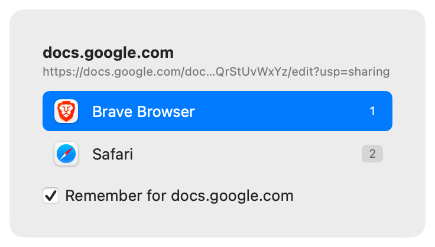
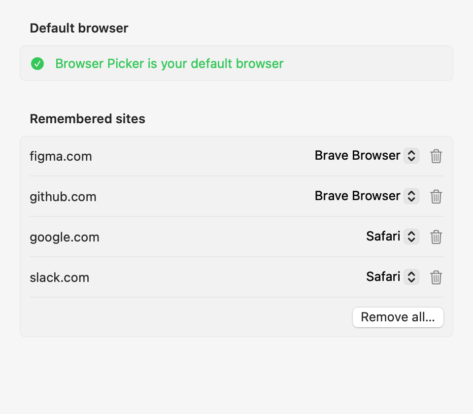

# Browser Picker

A small macOS menu bar app that becomes your default web browser and decides, for every `http`/`https` link, whether to open it straight away in a remembered browser or ask you which browser to use.

## What it does

- Registers as a web browser, so macOS sends it every `http`/`https` link you click in other apps.
- Links whose domain you have remembered open straight in the chosen browser, with no UI.
- Any other link shows a small keyboard-first picker at the cursor listing your installed browsers, with one row per profile for Chromium browsers and one row per Space for Arc.
- Runs in the menu bar only (no Dock icon). Everything stays on your Mac: no network, no link history.

<p align="center">
  
  
</p>

## Requirements

- macOS 14 or later
- Swift 6 toolchain (Xcode or the Xcode command line tools: `xcode-select --install`)

## Build and install

```bash
git clone <repo-url> browser_picker   # or use your existing checkout
cd browser_picker
scripts/build-app.sh
```

The script builds a release binary, assembles `Browser Picker.app`, signs it ad hoc, and installs it to `/Applications/Browser Picker.app`, next to your other apps (an admin account can do this without `sudo`). A running copy is quit first, and a copy left in `~/Applications` by an older build is removed. Without admin rights, install to your home folder instead: `INSTALL_DIR=~/Applications scripts/build-app.sh`. Run the tests with `swift test`. The app icon is drawn in `Resources/AppIcon.svg`; after changing it, run `scripts/make-icon.sh` (needs `brew install resvg`) to regenerate `Resources/AppIcon.icns`.

## Grant access (optional)

Browser Picker works without any extra permission. Two are needed only for profiles and Spaces:

- **Full Disk Access**, for Chrome and Brave profiles. macOS protects these browsers' data, so without the grant Browser Picker can't read their profile lists: Chrome and Brave show as single rows, with no prompt and no error. Arc Spaces don't need it. macOS has no prompt for this permission. When it's missing, Settings shows a **Profiles** notice naming the affected browsers, with an **Open Full Disk Access Settings…** button that opens the right pane; add `/Applications/Browser Picker.app` there with `+`. Back in Settings the notice disappears, and the next picker shows the profiles.
- **Automation → Arc**, to open links in an Arc Space. macOS asks the first time you pick a Space. If you deny it, the app shows an alert pointing to System Settings → Privacy & Security → Automation.

The app is signed ad hoc, so macOS ties these grants to the exact build. After running `scripts/build-app.sh` again, remove Browser Picker from Full Disk Access and add it again; switching the toggle is not enough. macOS may also ask about Arc again.

## Make it your default browser

1. Open `/Applications/Browser Picker.app`. It has no Dock icon; look for the menu bar item.
2. Choose **Settings…** from the menu bar item.
3. Click **Make default** and confirm the macOS prompt(s) (one for `http`, one for `https`).

Settings then shows "Browser Picker is your default browser". If the app is missing from System Settings → Desktop & Dock → Default web browser, see "Design risks" in `openspec/changes/add-browser-picker/design.md`.

## Using it

- Click a link anywhere. With no remembered rule, a picker appears at the cursor: press `1`–`9`, use the arrow keys and Return, or click. `Esc` or clicking elsewhere cancels.
- Tick **Remember for `<domain>`** (or press `R`) to send that domain (with or without `www.`) to the chosen browser from now on. Subdomains are separate: a `google.com` rule does not cover `maps.google.com`, which asks once and can be remembered on its own.
- Hold **Option (⌥)** while clicking a link to show the picker even when a rule exists; the remembered browser is highlighted.
- Opening the app again from Finder or Spotlight shows Settings.

## Profiles and Spaces

- **Chromium browsers**: Brave (release, Beta, Nightly), Google Chrome (release, Beta, Canary), Microsoft Edge (release, Beta, Dev), Vivaldi and Chromium. A browser with several profiles gets one row per profile, such as "Google Chrome — Work", sorted by profile name. With one profile it shows as a single row named after the browser. The link opens in that profile whether or not the browser is running. Only Brave and Chrome were tested; the others use the same mechanism.
- **Arc**: one row per Space, such as "Arc — Pro". The link opens as a new tab in that Space, and the Space becomes active. **Limited support:** this only works while Arc is running. If Arc is quit, the link opens the usual way, wherever Arc's own settings send external links (for example Little Arc), not in the chosen Space. Arc's own profiles, as distinct from Spaces, are not offered.
- **Safari and Firefox** stay single rows. Safari has no public way to open a link in a given profile, and Firefox profiles are not supported yet.
- Profiles and Spaces are read again whenever the picker or Settings opens, so new, renamed and deleted ones show up without restarting. Rules keep working after a rename.
- If a browser's profile list can't be read (for Chrome and Brave, without Full Disk Access), that browser shows as a single row, and rules naming one of its profiles show the picker instead. Browser Picker never launches a profile it hasn't just read, so it can't create an empty profile by accident.

## Managing rules

Settings → **Remembered sites** lists every rule. Change a rule's browser, profile or Space, delete one, or **Remove all…**. A rule whose browser is no longer installed, or whose profile or Space was deleted, is kept, labelled "not installed", "profile not found" or "Space not found", and applies again if it comes back.

Rules saved before profile support name only the browser. They keep working and open the browser's last-used profile (or Arc's current Space); Settings labels them "Google Chrome (last used profile)" or "Arc (current Space)" until you pick a specific one.

Rules match exact domains, not subdomains or paths. Google Meet and Google Maps can go to different places by remembering `meet.google.com` and `maps.google.com`, even alongside a `google.com` rule. Maps links on `www.google.com/maps/…` follow the `google.com` rule, since paths are not matched.

Rules are stored locally in `UserDefaults` (`dev.evgenyivanov.BrowserPicker`, key `domainRules`). No link history is kept and nothing is sent over the network.

## Known limitations

- Arc Spaces work only while Arc is running (see "Profiles and Spaces").
- If Browser Picker is not running when you Option-click a link, macOS launches it and you may release Option before the link arrives, so a remembered browser opens instead of the picker. The app stays running after the first launch, so this is rare.

## Roll back

1. Pick another browser in System Settings → Desktop & Dock → Default web browser.
2. Quit Browser Picker from its menu bar item.
3. Delete `/Applications/Browser Picker.app`.
4. Optional: `defaults delete dev.evgenyivanov.BrowserPicker` removes saved rules.
5. Optional: remove Browser Picker from Full Disk Access and Automation in System Settings → Privacy & Security.
